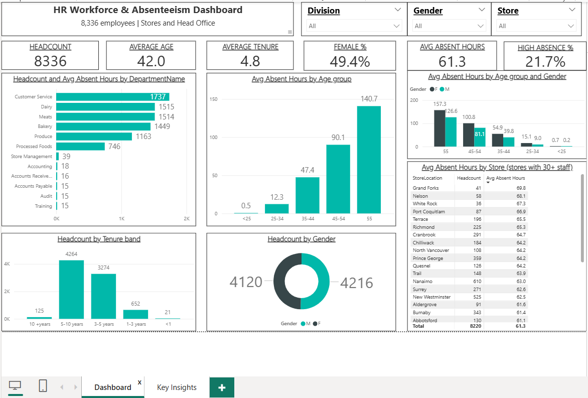

# HR Workforce & Absenteeism Dashboard (Power BI)

An interactive Power BI dashboard that profiles the workforce of a retail company (8,336 employees) and investigates **who is absent, how much, and why it might matter**. Built as an HR / People Analytics portfolio project.

## Business Problem
HR and operations leaders want to know:
- Who works here? (age, tenure, gender, department, store)
- Where is absenteeism concentrated?
- Which employee groups need attention, and what actions could HR take?

## Objectives
1. Clean and validate the employee dataset, and flag data-quality issues.
2. Build DAX measures for headcount, demographics and absenteeism.
3. Design a one-page dashboard with slicers, KPI cards and clear charts.
4. Turn the numbers into insights and recommendations that a manager can act on.

## Dataset
| Item | Detail |
|---|---|
| File | `HR-absent.csv` |
| Rows | 8,336 employees |
| Columns | 13 |

**Data dictionary**

| Column | Description |
|---|---|
| EmployeeNumber | Unique employee ID |
| Surname, GivenName | Employee name |
| Gender | F / M |
| Age | Age in years |
| City | Employee city |
| JobTitle | Job title |
| DepartmentName | Department |
| StoreLocation | Store or office location |
| Division | Division |
| BusinessUnit | Stores or Head Office |
| LengthService | Years of service |
| AbsentHours | Hours absent (assumed to be per year) |

## Tools Used
- **Power BI Desktop**: data modelling and dashboard design
- **Power Query**: data cleaning
- **DAX**: measures and calculated columns

## Data Preparation
- Set correct data types and fixed the department typo ("Accounts Receiveable").
- Created `Age Group` and `Tenure Band` columns, with helper columns to sort them in a logical order.
- Flagged **44 records with age under 16** and **144 records where service length is longer than working age allows**. These are likely data-entry errors. They were kept, and are noted here as a limitation.
- The store table only shows locations with 30+ employees, so a few very small stores do not distort the averages.

## Key Measures (DAX)
Headcount = DISTINCTCOUNT(Employees[EmployeeNumber])
Avg Age = AVERAGE(Employees[Age])
Avg Tenure = AVERAGE(Employees[LengthService])
Female Headcount = CALCULATE([Headcount], Employees[Gender] = "F")
Female % = DIVIDE([Female Headcount], [Headcount])
Total Absent Hours = SUM(Employees[AbsentHours])
Avg Absent Hours = DIVIDE([Total Absent Hours], [Headcount])
High Absence Employees = CALCULATE([Headcount], Employees[AbsentHours] > 100)
High Absence % = DIVIDE([High Absence Employees], [Headcount])
Calculated columns: `Age Group`, `Tenure Band` (with matching sort-order columns).

## Business Questions → Measures → Results

| Question | Measure / Visual | Result |
|---|---|---|
| How big is the workforce? | Headcount | 8,336 employees |
| Who works here? | Avg Age, Avg Tenure, Female % | Age 42.0, tenure 4.8 yrs, 49.4% female |
| Where do people work? | Headcount by Department | Customer Service is largest (1,737) |
| How much is absence? | Avg Absent Hours | 61.3 hours per employee |
| Does absence change with age? | Avg Absent Hours by Age Group | Rises from about 1 hour (<25) to 141 hours (55+) |
| Is there a gender difference? | Avg Absent Hours by Age Group and Gender | Women are higher in every age group |
| Which stores stand out? | Avg Absent Hours by Store | Grand Forks, Nelson and White Rock are highest |

## Key Insights
1. **Most staff work in six store departments.** Over 97% of the 8,336 employees work in Customer Service, Dairy, Meats, Bakery, Produce or Processed Foods. Support teams such as Accounting, Audit and Training have fewer than 40 people each.
2. **The workforce is balanced and experienced.** There are 4,120 women and 4,216 men. About 9 in 10 employees have 3-10 years of service, and very few are brand new (21) or long-serving (125).
3. **Absence rises sharply with age.** Average absent hours go from about 1 (under 25) to 12 (25-34), 47 (35-44), 90 (45-54) and 141 (55+).
4. **Women have higher absence than men at every age.** For example, in the 45-54 group women average 101 hours vs 81 for men. Age alone does not explain the gap.
5. **One in five employees has high absence.** 21.7% miss more than 100 hours, against a company average of 61.3.
6. **A few stores are above average.** Among stores with 30+ staff, Grand Forks (about 70 hours), Nelson (68) and White Rock (67) are highest.

## Recommendations
- Focus attendance and wellness support on employees aged 45 and above.
- Look into why women's absence is higher (for example leave rules or shift timing) before drawing conclusions.
- Review the highest-absence stores for local causes such as workload or staffing.

## Assumptions & Limitations
- `AbsentHours` is assumed to be annual. The dataset has no date column, so trends over time cannot be analysed.
- The dataset has no attrition, salary or performance data, so this project covers workforce profile and absenteeism only.
- `Age Group` and `Tenure Band` are based on rounded values, so employees near a band boundary can fall into the neighbouring band.
- Findings show association, not cause. The reasons behind the patterns need further investigation.
- A few age and tenure records look invalid (see Data Preparation).

## Repository Structure
HR-Workforce-Absenteeism-PowerBI/
├──  README.md
├──  HR-absent.csv          # dataset
├──  HR-Absentism.pbix      # Power BI report file
├──  Ab1.png                # dashboard screenshot
└──  Ab2.png                # dashboard screenshot

## How to Use
1. Download `HR-Absentism.pbix` from this repository.
2. Open it in Power BI Desktop (free).
3. If prompted, point the data source to `HR-absent.csv`.
4. Use the Division, Gender and Store slicers to explore the data.

## Skills Demonstrated
Data cleaning and validation · DAX measures · KPI and chart design · Dashboard storytelling · HR analytics · Insight and recommendation writing

## Author
**Amruthesh P K**
MBA (HR) | Transitioning into HR Analytics / People Analytics
- GitHub: [amrutheshpk1](https://github.com/amrutheshpk1)
- LinkedIn: https://www.linkedin.com/in/amruthesh-p-k/
